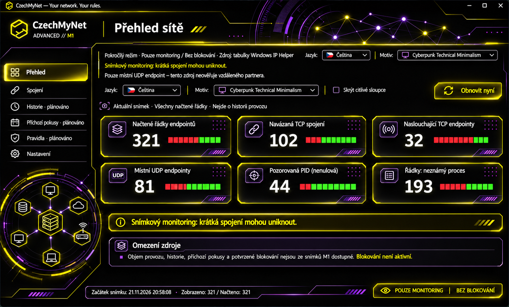
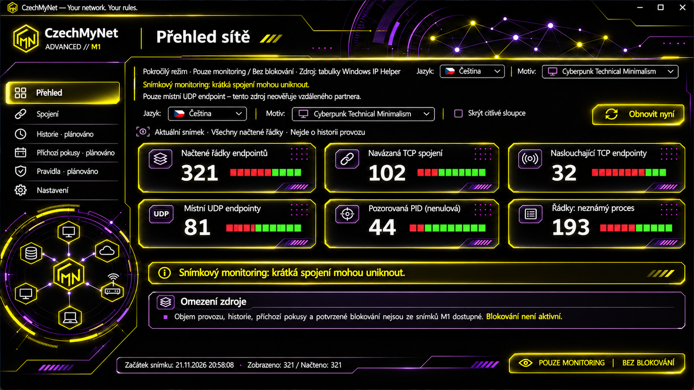

# CzechMyNet

**Your network. Your rules. — Vaše síť. Vaše pravidla.**

*Nenáročný nástroj pro monitorování sítě a ochranu soukromí ve Windows. Ve vývoji.*

**Stav: Aktivní vývoj · Zatím není ke stažení**

[English](README.md) · [Stav vývoje](STATUS.md) · [Plán vývoje](ROADMAP.md)

---

## O projektu

CzechMyNet je nezávisle vyvíjená aplikace pro Windows, jejímž cílem je přehlednější sledování síťové komunikace a postupně také její ovládání. Uživatel má vidět, které aplikace komunikují po síti, a mít dostatek informací, aby mohl sám rozhodovat, čemu důvěřuje.

> CzechMyNet nerozhoduje, čemu máte důvěřovat. Dává vám informace a nástroje, abyste o tom mohli rozhodovat sami.

## Skutečný stav aplikace

*Skutečný snímek experimentální vývojové verze; nejde o vydaný produkt.*

### Co už funguje

- Snímkový přehled TCP spojení a naslouchajících endpointů ve Windows (IPv4/IPv6).
- Přehled místních UDP endpointů; tento zdroj však neověřuje vzdáleného UDP partnera.
- Přiřazení procesu tam, kde to Windows umožňuje.
- Filtrování, řazení, obnovení a nativní grafické rozhraní.
- České a anglické varianty rozhraní a experimentální podpora motivů.

**Omezení:** Snímkový monitoring může přehlédnout velmi krátká spojení. Nejde o zachytávání paketů, ze snímků nelze spolehlivě určit objem přenesených dat a aplikace nyní spojení neblokuje.

### Co připravujeme

- Událostní monitoring i pro krátká spojení.
- Historii síťové aktivity s uvedením zdroje a spolehlivosti údajů.
- Nezávislé blokování podle rozhodnutí uživatele, bez zásahu do nastavení Windows Defender Firewallu.
- Přehled skutečně pozorovaných příchozích pokusů a zablokovaného provozu.
- Volitelnou identifikaci IP adres pouze na výslovnou žádost uživatele.
- Dotažené, přizpůsobitelné grafické rozhraní.

## Vizuální návrh

*Grafický koncept budoucího rozhraní, nikoliv aktuální screenshot. Číselné údaje a funkce v návrhu nepředstavují naměřená data.*

## Zásady projektu

- **Rozhoduje uživatel.** Žádný program nemá automaticky určovat, čemu smíte věřit.
- **Soukromí.** Lokální zpracování, bez telemetrie a zbytečných externích služeb.
- **Nízká zátěž.** Nativní aplikace s důrazem na měřitelnou efektivitu.
- **Pravdivé údaje.** Žádné vymyšlené síťové události, počítadla nebo bezpečnostní tvrzení.
- **Bezpečná integrace.** Plánovaný blokovací modul je oddělený a nemění konfiguraci vestavěné brány Windows Firewall.

## Dostupnost

**Zatím neexistuje veřejně dostupná instalační ani spustitelná verze.** Tento repozitář slouží pouze k představení projektu. Skutečný vývojový repozitář a zdrojové kódy zůstávají soukromé.

Termín vydání zatím není stanoven. Dostupnost kódu a přesné licenční podmínky oznámíme později.

---

*Nezávislý projekt vznikající v České republice. Aktualizováno 23. listopadu 2026.*
