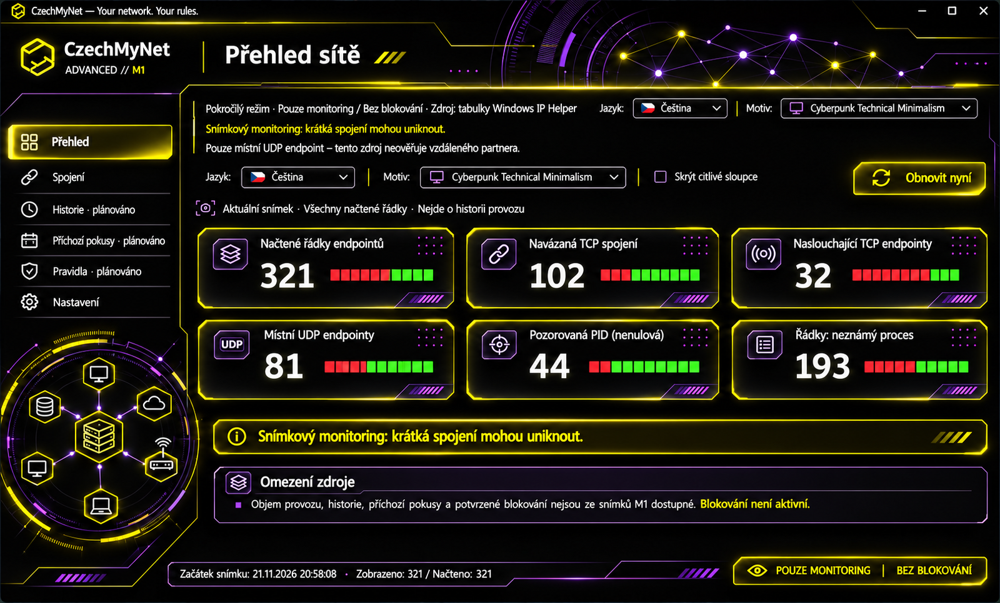
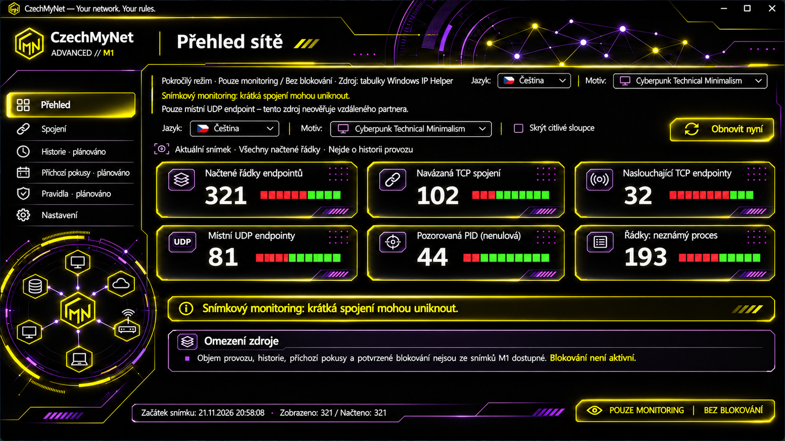

# CzechMyNet

**Your network. Your rules.**

*A lightweight Windows network monitor and privacy tool in development.*

**Status: Active development · Not available for download**

[Česky](README.cs.md) · [Development status](STATUS.md) · [Roadmap](ROADMAP.md)

---

## What is CzechMyNet?

CzechMyNet is an independent Windows application being built to make network activity more visible and, eventually, easier to control. The aim is to help users see which applications have network endpoints and connections, understand what is happening, and make their own decisions about network access.

It is designed around local processing, low resource usage, and a clear distinction between information that is actually observed and information that cannot be inferred from the current data source.

> CzechMyNet doesn't decide what you should trust. It gives you the information and tools to decide for yourself.

## Current development preview

*Actual application screenshot from a development build. This is an experimental monitoring interface, not a released product.*

### What already works in development builds

- Read-only snapshots of Windows TCP connections and listening endpoints, with IPv4/IPv6 support.
- Local UDP endpoint visibility (a snapshot does **not** reliably identify a remote UDP peer).
- Process association where Windows exposes the necessary information.
- Filtering, sorting, refresh controls and a native Windows GUI.
- Czech and English interface variants and experimental theme support.

**Important limitation:** The current snapshot-based monitor may miss short-lived connections. It is not a packet capture tool, cannot show accurate transferred byte counts from snapshots, and does not currently block connections.

### What is planned

- Event-based connection monitoring with better visibility into short-lived network activity.
- Connection and event history with clear source and confidence information.
- Independent, user-controlled blocking that does not modify Windows Defender Firewall settings.
- An intrusion-watch view for observed inbound attempts and blocked traffic once reliable data is available.
- Optional, user-initiated IP ownership and network information lookup; no automatic third-party queries.
- A polished, customizable interface and approachable explanations of network activity.

## Visual direction

*UI design concept — this is a visual target, not a screenshot of the current application. Features and numbers shown in concept artwork should not be interpreted as measured data.*

## Project principles

- **User control:** The user decides what to trust and what to block.
- **Privacy:** Local-first behavior, no telemetry, no unnecessary external services.
- **Performance:** Native Windows software, with resource usage tested rather than assumed.
- **Honest reporting:** No invented network activity, inaccurate counters or misleading security claims.
- **Safe integration:** Planned blocking is separate from monitoring and will not reconfigure the built-in Windows Firewall.

## Availability and source code

**There is no public release, installer, or downloadable application at this time.** This repository is a public information page only. The actual development repository and source code remain private while the software is being developed and reviewed.

No release date is being promised yet. A public release, source availability and licensing terms will be announced separately when decided.

For now, follow the public development updates and check [STATUS.md](STATUS.md) for the current scope.

---

*Independent project developed in Czechia. Last public status update: 23 November 2026.*
